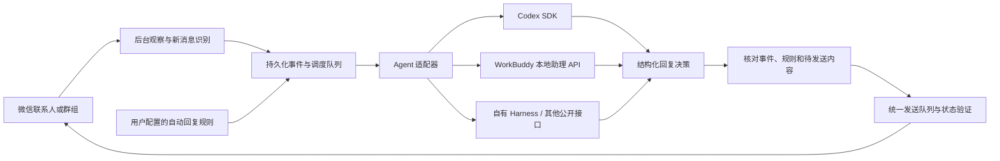

# 无人值守自动回复与第三方 Agent 接入

日期：2026-09-04。本文为架构方案；0.3.0 已完成本地 DeepSeek Harness 适配器、持久任务与自动回复控制面，实际实现范围和使用方式见 [无人值守自动回复](auto-reply.md)。Codex/WorkBuddy 适配器仍为后续方案。本文中的未落地接口不能当作现有工具调用。

## 产品决定

无人值守自动回复是必须支持的产品能力。用户为指定联系人或群组启用规则并选择执行 Agent 后，运行时负责持续发现新消息、触发 Agent、验证回复和后台发送；授权范围内不逐条审批。规则可暂停、撤销，并显示处理进度与失败原因。

交互式 MCP 工具与后台自动回复共用同一微信运行时、操作队列和发送记录。微信驱动不内置模型，也不依赖某个聊天产品始终处于推理状态。

## 已核实的第三方入口

### Codex

官方 SDK 支持程序发起执行并继续同一会话；推荐作为自动任务适配器。需要更细的事件与执行控制时，可使用 App Server 的 `thread/start`、`thread/resume`、`turn/start`。本机 `codex app-server --help` 和 `codex exec --help` 均存在。尚未进行自动回复端到端联调。

每个授权会话映射独立的 Agent 会话，持久化 ID；不复用用户正在开发的任务。接入 Codex 执行引擎不等于能够远程操控桌面端任意现有任务，也不承诺结果自动出现在当前桌面聊天。产品自己展示执行记录。锁定 SDK/运行时版本；App Server 的实验性接口和 WebSocket 不作为未经验证的生产稳定性承诺。

依据：[Codex SDK](https://learn.chatgpt.com/docs/codex-sdk)、[App Server](https://learn.chatgpt.com/docs/app-server)、[非交互执行](https://learn.chatgpt.com/docs/non-interactive-mode)。

### WorkBuddy 桌面本地助理

官方 Open API 明确提供：

- `GET /openapi/v2/localassistant`：查询 PC 助理是否在线。
- `POST /openapi/v2/localassistant/message`：提交文本，触发 PC 助理执行任务。
- `GET /openapi/v2/localassistant/message?message_id=...`：增量查询后续回复。

第三方应用需完成平台注册和相应审核，由用户授予 `user.localassistant.invokable` 与 `user.localassistant.readable` 等实际需要的权限。通过正式 OAuth 流程取得凭据，不能复用桌面内部登录数据。凭据存储、刷新与服务端交换遵循平台文档，不把应用密钥打包到公开客户端。

本地助理接口公开字段没有指定独立聊天会话 ID 的能力。适配器先按助理账号串行派发任务，携带明确的 job/event 标识与该微信会话所需上下文，并校验返回关联；不把任意最新助理消息当作回复结果。多群并发与严格上下文隔离需要额外联调，必要时采用平台支持的独立任务通道。

本次已获取中文官方正文；中英文对 `permission_response` 的说明有差异，不能以自动回答审批作为无人值守方案。正常流程只提交任务文本，遇到宿主未授予的权限进入需要处理状态。

依据：[Open API](https://open.workbuddy.cn/docs/openapi)、[第三方应用注册与授权](https://open.workbuddy.cn/docs/third-party-app)。当前未注册应用、未获得 OAuth 授权，也未验证本机助理通道。

### CodeBuddy Code 与自有 Harness

腾讯另外提供 CodeBuddy Code HTTP API（Beta）：`codebuddy --serve` 后由 `POST /api/v1/runs` 发起 Agent 执行，查询状态或读取 SSE 结果。它是单独适配器，不等同于 WorkBuddy 桌面本地助理。本机 PATH 未发现 codebuddy 命令，尚未联调。

依据：[CodeBuddy Code HTTP API](https://cloud.tencent.com/document/product/1831/137064)。

自有 DeepSeek Harness 直接实现同一适配器契约即可。连接的是可执行 Agent 时，保留其必要的检索、工具与上下文能力；仅连接模型 API 时，产品需要自行提供 agent 循环，不能标称已接入某个第三方 Agent 产品。

## MCP 的职责与边界

MCP 提供读取消息、查询待处理事件等工具。增加 `wait_for_events` 可以支持已经运行的 Agent 等待，但不能保证空闲客户端自动开始下一轮。资源更新通知也不等于客户端必定运行模型。不能把 sampling 当作跨客户端通用的后台唤醒协议；需要协商客户端能力并符合所用协议版本的请求关联要求。

当前服务协议版本为 `2025-03-26`，没有实现 sampling 或持久订阅。较新协议限制不能反向描述为当前代码已经支持的行为。依据：[当前版本 sampling](https://modelcontextprotocol.io/specification/2025-03-26/client/sampling)、[请求关联说明](https://modelcontextprotocol.io/seps/2260-Require-Server-requests-to-be-associated-with-Client-requests)。

接入分级：公开 SDK/API/CLI 的 Agent 可由适配器触发；只支持计划任务的客户端可定期拉取待处理事件；只有交互式 MCP 的客户端仅支持主动调用，不宣传实时无人值守。计划任务属于兼容模式，具体频率以宿主实际能力为准。

## 规则与权限

产品设置包含：联系人或群组、启用状态、执行 Agent、回复风格/知识来源、触发条件、工作时段、发送频率与暂停按钮。群组可设置所有新消息、仅被提及或关键词触发；仅在驱动可靠提供对应字段时开放该条件。

运行时规则至少保存 `rule_id`、版本、账号/Provider、会话 ID 与已确认身份、适配器身份、触发条件、启用时间及撤销时间。用户启用规则即授予该范围内的持续回复权限。微信消息不能修改规则或扩展权限。

保留交互式的 `user_directed` 行为，在规则内增设自动回复授权判断；不将全局发送策略简单替换为全开放模式。自动回复来源仍是 `agent_proposed`，是否发送由服务端规则与事件绑定决定，不能由模型自报 `user_request` 决定。

现有共享 HTTP 服务把 Codex/WorkBuddy 都记为 `local-agent`；多适配器产品化时必须引入认证凭据到真实执行主体的映射，不能靠模型参数区分权限。

## 监听、执行和发送

1. 为授权会话建立初始基线；首次启用不回复已有历史。后台观察只执行轻量读取，没有新消息不运行模型。轮询间隔是目标配置，实际延迟包含串行 OCR、会话数量、模型与发送耗时，需测量后公布。
2. 对比有序消息序列及上下文锚点，保留方向、可识别发送者和 OCR 证据。当前观察 ID 随快照变化，不是原生消息 ID；相同正文可以是两条消息。识别不确定、窗口跳转或历史断层时暂停该会话自动发送，不伪造可靠增量。
3. 将确认的新消息与本地稳定 event_id 写入 SQLite；连续消息短暂合并。持久化消费游标、任务租约、重试次数、规则版本和关联的 Agent 会话 ID。同一会话只允许一个处理任务；微信窗口操作全局串行。
4. 适配器只接受已授权事件，返回 `reply`、`skip` 或 `needs_user` 决策。第三方聊天内容作为外部数据传入，不能提升为用户授权或执行系统指令。
5. 决策携带 job_id、event_id、rule_version、正文和运行标识。后台自动回复的发送责任统一归 Runtime；适配器不同时直接调用微信发送工具，以免最终输出和工具各发送一次。需要 agent 工具时先提供受范围限制的读取能力。
6. 在本地事务中保存决策与 outbox。每个回复固定一个 request_id，发送前再次检查规则未撤销、任务未过期、会话未被人工接管以及是否出现需重新处理的新消息。
7. 继续复用标题、窗口、草稿、发送前读回与发送后验证。`sending`/`uncertain` 不自动重发；外部执行超时也不能立即创建另一个可能并行的回复任务。
8. 事件可以重复投递，但只有一个已持久化决策拥有发送资格。提交开始后崩溃保留不确定状态，不能承诺物理消息 exactly-once 或对方已收到。

停止规则时立即阻止新任务与尚未提交的发送；在途模型结果到达后丢弃。人工输入的不同草稿保持不动。人工发送需要观察后暂停自动回复，避免抢答；已经进入物理提交的消息无法由暂停追溯撤回。

## 待实现接口（名称为方案，不是现有可调用工具）

| 接口 | 职责 |
|---|---|
| `set_auto_reply_rule` / `pause_auto_reply_rule` | 可信用户控制面管理授权范围；不是对方消息可调用的工具 |
| `get_auto_reply_status` | 显示会话状态、最近观察时间、覆盖范围与阻塞原因 |
| `get_events` / `wait_for_events` | 鉴权后按授权范围和游标读取事件 |
| `claim_reply_job` | 原子领取任务，绑定执行主体和有效租约 |
| `complete_reply_job` | 校验事件、规则版本、租约及决策，持久化 outbox |
| `get_reply_job` | 查询执行、跳过、待用户处理、发送与不确定状态 |

模型生成耗时期间不占用微信窗口锁。规则存储、事件表、任务表、决策表和 outbox 与旧发送幂等记录共存，不删除旧记录来恢复任务。

## 验收与演示

- Wencharm 发来新消息，界面连续显示“发现消息 → Agent 处理 → 已提交发送”，无需用户再次输入；展示实际检测与回复延迟。
- 至少一个实际群组完成同样验证；发言者与提及信息不足时禁用相关触发模式，不把私聊测试当成群聊通过。
- 微信被其他窗口覆盖时完成收发；当前驱动仍要求登录、非最小化且可截图。锁屏、休眠和无人登录运行尚未支持，不纳入宣传承诺。
- 相同文字连续发送、OCR 细微变化、消息连发、同一会话重入、两个 Agent 同时领取任务均不产生重复回复。
- 进程重启、网络断开、OAuth 过期、模型超时、宿主审批以及发送状态不确定均有可见状态和恢复方式。
- 规则关闭后不再提交新的发送；旧历史、自己发出的消息和未授权会话均不会触发回复。
- 端到端验收通过前，宣传写“开发中的自动回复能力”；通过后按已验证的 Agent、会话类型和桌面环境列出兼容范围。

实现顺序：先完成共用规则、观察增量、持久任务与发送链路，以自有 Harness/Codex SDK 验证单联系人；随后接入 WorkBuddy 正式授权流程，并补齐群组解析及多会话验收。第三方适配器不能弥补底层漏读，监听可靠性和宿主唤醒能力需要分别验收。
